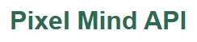

# 🧠 Pixel Mind API — Classificação de dígitos manuscritos

API REST em Python que recebe uma imagem enviada pelo usuário, prepara a imagem para o padrão MNIST e realiza inferência com três modelos: **KNN**, **Random Forest** e **rede neural MLP**. O resultado desta aplicação é a classe prevista por cada modelo, confiança estimada e métricas de avaliação (acurácia e F1-Score) calculadas previamente no conjunto de teste. Os modelos são registrados e carregados com **MLflow**.

> A aplicação foi construída a partir do pipeline `pixel_pipeline.ipynb` desenvolvida no mini-projeto do módulo 2, um pipeline preditivo ponta a ponta de Visão Computacional e Machine Learning focado na classificação de dígitos manuscritos (*MNIST dataset*). O projeto explora a transição da extração de matrizes de pixels para modelos estatísticos clássicos e redes neurais profundas, incluindo testes rigorosos com imagens próprias ✍️🎨

## 1. Objetivo 🎯

Disponibilizar um modelo preditivo treinado para classificação de dígitos manuscritos por meio de uma API REST pronta para ser consumida por outras aplicações. A API oferece:
- `GET /health`: verifica se a API está ativa e se os três modelos estão carregados na memória.
- `POST /predict`: recebe uma imagem e retorna as previsões dos três modelos.
- Validação de entrada e erros HTTP apropriados.
- Métricas de avaliação obtidas de um conjunto de teste separado do treinamento.

## 2. Base de dados e modelos ✍️

### MNIST
Foi utilizada a base pública **MNIST**, com 70.000 imagens em escala de cinza de dígitos de 0 a 9. Cada imagem tem 28 × 28 pixels (784 valores), originalmente entre 0 e 255. O script baixa a base pelo OpenML na primeira execução; é necessária conexão com a internet nessa etapa.

A divisão é estratificada por classe: 70% treinamento, 10% validação e 20% teste. O `MinMaxScaler` é ajustado somente no conjunto de treinamento e aplicado aos demais conjuntos para evitar vazamento de dados. As métricas apresentadas são calculadas no conjunto de teste.

### Modelos
- **KNN**: 5 vizinhos, pesos por distância.
- **Random Forest**: 100 árvores e profundidade máxima 20.
- **MLP**: camadas densas 128 e 64 neurônios com ReLU; saída de 10 classes com Softmax; Adam com taxa de aprendizado 0,001; 15 épocas e lote de 64.

Acurácia e F1-Score ponderado são calculados separadamente para cada modelo. Os números reais aparecem em `models/metrics.json` após o treinamento; não são valores fixos no código.

### Imagem enviada
A imagem é convertida para escala de cinza, ajustada para fundo preto/traço claro quando necessário, recortada em torno do traço, centralizada em uma tela 28 × 28 e normalizada para [0, 1]. Recomenda-se enviar **um único dígito manuscrito**, com bom contraste e sem outros elementos.

**Limitação importante:** MNIST ensina os modelos a escolher entre os dígitos 0–9, não a reconhecer qualquer objeto ou texto. A aplicação usa verificações simples de conteúdo e confiança para sinalizar casos incertos, o modelo pode apresentar uma confiança elevada mesmo quando está diante de uma situação que não conhece. Esse comportamento é relacionado ao conceito de **overconfidence**, ou falsa certeza, onde uma letra ou objeto pode, em alguns casos, ser classificado como dígito.

## 3. Tecnologias utilizadas 🛠️

| Biblioteca | Aplicação| Versão |
|---|----|---:|
| Python | linguagem principal | 3.11.x recomendado |
| FastAPI | criação da API REST e documentação interativa | 0.115.4 |
| Uvicorn | servidor ASGI para executar a API | 0.32.0 |
| Pydantic | validação dos esquemas de entrada e saída | 2.9.2 |
| scikit-learn | KNN, Random Forest, divisão de dados, normalização e métricas | 1.5.2 |
| NumPy | processamento de pixels e imagens | 1.26.4 |
| TensorFlow | rede neural MLP | 2.17.1 |
| MLflow | registro dos modelos treinados e acompanhamento do experimento | 2.17.2 |
| OpenML | obtenção da base MNIST | -- |
| Pillow | processamento de pixels e imagens | 11.0.0 |


## 4. Estrutura do  📂

```text
pixel_mind_api/
├── app/
│   ├── __init__.py
│   ├── main.py          # FastAPI e lifespan
│   ├── routers.py       # endpoints e tratamento HTTP
│   ├── schemas.py       # contratos Pydantic
│   └── services.py      # carregamento, imagem e inferência
│
├── data/
│   └── .gitkeep
│
├── mlruns/              # criado pelo MLflow durante a execução (não versionado)
├── models/
│   └── .gitkeep         # métricas e URIs são gerados no treinamento
│
├── training/
│   ├── __init__.py
│   └── train.py         # treinamento, avaliação e logging MLflow
│
├── mlflow.db           # banco SQLite criado para armazenamento dos dados
├── README.md
└── requirements.txt
```

## 5. Instalação e execução — passo a passo 🏁

Os comandos abaixo são para Windows com PowerShell. Instale antes o **Python 3.11 (64 bits)** e o Git, se ainda não estiverem instalados.

### Passo 1 — Abra a pasta do projeto
Baixe/clonе o repositório e abra a pasta `pixel_mind_api` no VS Code. No menu **Terminal → Novo Terminal**, confirme que o terminal está dentro da pasta do projeto.

### Passo 2 — Crie um ambiente virtual

```powershell
python -m venv .venv
```

Ative o ambiente:

```powershell
.\.venv\Scripts\Activate.ps1
```

Confirme que o terminal mostra `(.venv)` no início da linha.

### Passo 3 — Instale as bibliotecas

```powershell
python -m pip install --upgrade pip
python -m pip install -r requirements.txt
```

### Passo 4 — Treine e registre os modelos

```powershell
python -m training.train
```

Esse passo baixa o MNIST, treina os três modelos, calcula acurácia e F1-Score no teste e registra os modelos no MLflow. Pode levar vários minutos e requer internet na primeira execução. Ao terminar, devem existir `models/metrics.json`, `models/model_uris.json` e a pasta local `mlruns/`.

**Execute o treinamento antes de iniciar a API.**

### Passo 5 — Inicie a API

```powershell
uvicorn app.main:app --reload
```

Quando o servidor iniciar, abra no navegador:
- Interface para enviar a imagem e visualizar os resultados: http://127.0.0.1:8000/
- Documentação interativa Swagger: http://127.0.0.1:8000/docs
- Documentação alternativa ReDoc: http://127.0.0.1:8000/redoc
- Saúde: http://127.0.0.1:8000/health

Para parar o servidor, volte ao terminal e pressione `Ctrl + C`.

## 6. Documentação da API

### `GET /health`

Verifica se a API está ativa e se KNN, Random Forest e MLP foram carregados na memória.

Exemplo de resposta `200 OK`:

```json
{
  "status": "ok",
  "message": "API e modelos carregados.",
  "models_loaded": {
    "KNN": true,
    "Random Forest": true,
    "MLP": true
  }
}
```

Se um modelo não estiver disponível, a resposta informa `degraded`. A inicialização também falha se os arquivos de treinamento não existirem.

### `POST /predict`

Recebe um arquivo de imagem como `multipart/form-data`. Formatos aceitos: PNG, JPEG, BMP e WEBP; tamanho máximo: 10 MB.

Exemplo com `curl` (Windows PowerShell pode ter alias próprio para `curl`; use `curl.exe`):

```powershell
curl.exe -X POST "http://127.0.0.1:8000/predict" `
  -H "accept: application/json" `
  -F "file=@C:\caminho\para\meu_digito.png;type=image/png"
```

Também é possível usar a página http://127.0.0.1:8000/docs: abra `POST /predict`, clique em **Try it out**, escolha a imagem no campo `file` e clique em **Execute**.

Exemplo ilustrativo de resposta `200 OK` (os valores variam conforme a imagem e o treinamento):

```json
{
  "is_digit": true,
  "message": "Dígito analisado com sucesso.",
  "processed_image_base64": "iVBORw0KGgoAAA...",
  "image_width": 28,
  "image_height": 28,
  "predictions": [
    {
      "model": "KNN",
      "predicted_digit": 4,
      "confidence": 0.91,
      "metrics": {
        "accuracy": 0.96,
        "f1_score": 0.96,
        "dataset": "MNIST - conjunto de teste"
      }
    },
    {
      "model": "Random Forest",
      "predicted_digit": 4,
      "confidence": 0.84,
      "metrics": {
        "accuracy": 0.96,
        "f1_score": 0.96,
        "dataset": "MNIST - conjunto de teste"
      }
    },
    {
      "model": "MLP",
      "predicted_digit": 4,
      "confidence": 0.98,
      "metrics": {
        "accuracy": 0.98,
        "f1_score": 0.98,
        "dataset": "MNIST - conjunto de teste"
      }
    }
  ],
  "note": "A detecção de conteúdo não numérico é heurística..."
}
```

**Atenção:** a resposta acima é apenas um exemplo de formato, com valores ilustrativos. Use os valores produzidos pelo treinamento em sua execução. `processed_image_base64` contém a imagem normalizada em PNG e pode ser decodificada por uma aplicação cliente para exibição.

### Códigos HTTP e erros

| Status | Significado |
|---|---|
| `200 OK` | Requisição processada; confira `is_digit` para saber se a identificação foi considerada confiável. |
| `400 Bad Request` | Arquivo vazio, imagem inválida ou dimensões inadequadas. |
| `413 Payload Too Large` | Arquivo acima de 10 MB. |
| `415 Unsupported Media Type` | Tipo de conteúdo não aceito. |
| `422 Unprocessable Entity` | Falha de validação do FastAPI/Pydantic, por exemplo campo `file` ausente. |
| `500 Internal Server Error` | Erro inesperado durante a inferência; detalhes internos não são expostos. |
| `503 Service Unavailable` | Artefatos/modelos indisponíveis para inferência. |

## 🎥 Demonstração e Explicação em Vídeo

O vídeo explicativo detalhando os objetivos do sistema, a organização das tarefas, os desafios enfrentados e a tomada de decisões técnicas está disponível no link abaixo:
<p align="center">
    <a href="https://drive.google.com/file/d/1i6f8Xa_1D8BvFmoCTciYs55VdsLNO24W/view?usp=drive_link" target="_blank">
    
    </a>
    <br>
    <em>Clique na imagem para assistir à apresentação deste projeto.</em>
</p>

---

# Autor

**Marcelo Yukio Takahashi**

Engenheiro Eletricista

Especialista em Projetos e Manutenção

Analista e Ciêntista de Dados
